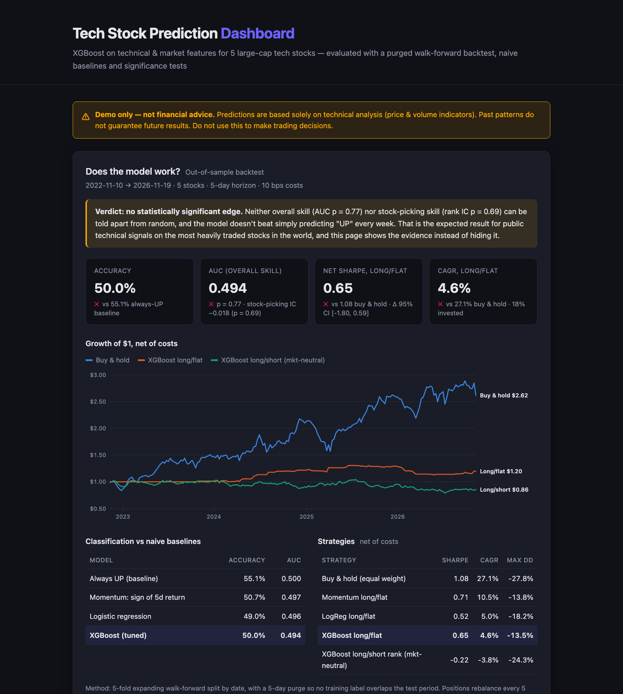
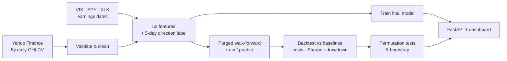

# Stock Direction Prediction: an honest ML backtest

[](https://github.com/NGUYENTHINHPHAT/stock-prediction-pipeline/actions/workflows/tests.yml)


**Live demo → [stock prediction dashboard](https://PhatNguyen39-Stock-Prediction-Pipeline.hf.space/dashboard)**

This is an end-to-end machine-learning pipeline that predicts whether AAPL, MSFT, GOOGL, AMZN and TSLA will be up or down a week from now. It then tests that prediction the way a quant research team would: leakage-safe walk-forward evaluation, a backtest with transaction costs, naive baselines, and permutation tests for statistical significance.

**The result is negative, and that is the point.** On public technical indicators for the most heavily traded stocks in the world, the model has **no statistically significant edge**: AUC 0.49, p = 0.77. It does not beat simply predicting "up" every week. The project shows how to reach that conclusion rigorously instead of reporting a lucky 57% accuracy from a leaky split.



---

## Key results

Out-of-sample **Nov 2022 → Nov 2026**, 5-fold purged walk-forward, 5-day horizon, weekly non-overlapping rebalances, **10 bps** cost per unit of turnover. Full report: [`results/backtest_report.md`](results/backtest_report.md).

| Model | Accuracy | AUC |
|---|---|---|
| Always predict UP (baseline) | **55.1%** | 0.500 |
| Momentum: sign of 5-day return | 50.7% | 0.497 |
| Logistic regression | 49.0% | 0.496 |
| **XGBoost (tuned)** | 50.0% | 0.494 |

| Strategy (net of costs) | Sharpe | CAGR | Max drawdown | Time invested |
|---|---|---|---|---|
| Buy & hold, equal weight | **1.08** | **27.1%** | −27.8% | 100% |
| Momentum long/flat | 0.71 | 10.5% | −13.8% | 54% |
| XGBoost long/flat (P(up) > 0.55) | 0.65 | 4.6% | −13.5% | 18% |
| XGBoost long/short, market-neutral | −0.22 | −3.8% | −24.3% | 100% |

**Is any edge real?**

| Test | Statistic | p-value |
|---|---|---|
| Overall skill: AUC, labels permuted (1,010 non-overlapping obs) | AUC 0.485 vs null 0.499 | **0.77** |
| Stock-picking skill: mean weekly rank IC, returns shuffled *within* each date | IC −0.018 | **0.69** |
| Block bootstrap, Sharpe(model) − Sharpe(buy & hold) | −0.43, 95% CI [−1.80, +0.59] | n/a |

**Reading the results**
- **The model doesn't beat the base rate.** In a 4-year bull market for mega-cap tech, "always up" was right 55% of the time, and nothing here beats it.
- **The lower drawdown isn't skill.** The long/flat strategy sits in cash 82% of the time, which is why its drawdown is smaller. Buy & hold still earned roughly 6× the return.
- **The cleanest test of stock picking fails.** The market-neutral version removes market direction, and it loses money, which matches the slightly negative rank IC.
- **This is what market efficiency predicts.** Freely available price and volume indicators on the most-traded stocks shouldn't carry an edge. A model claiming 80% accuracy here almost certainly has leakage.

---

## What this project demonstrates

| Area | Where to look |
|---|---|
| **Leakage-safe time-series validation.** Splits by date, not row, with a purge gap equal to the label horizon. The early-stopping slice is purged too. | [`src/models/trainer.py`](src/models/trainer.py), [`tests/test_leakage.py`](tests/test_leakage.py) |
| **Quant backtesting.** Non-overlapping rebalances, turnover-based costs, Sharpe, CAGR, max drawdown, cost sensitivity, market-neutral long/short. | [`src/evaluation/backtest.py`](src/evaluation/backtest.py) |
| **Statistical inference.** Permutation tests matched to the right null (full shuffle for AUC, within-date shuffle for rank IC) and a moving-block bootstrap for the Sharpe difference. | [`src/evaluation/backtest.py`](src/evaluation/backtest.py), [`tests/test_backtest.py`](tests/test_backtest.py) |
| **Baselines before models.** Always-up, momentum and logistic regression go through the same pipeline as XGBoost. | [`scripts/backtest.py`](scripts/backtest.py) |
| **Feature engineering.** 52 features: returns, momentum, RSI, MACD, Bollinger, ATR, stochastic, lags, calendar, plus VIX, SPY, the XLK sector ETF and days to earnings. | [`src/data/features.py`](src/data/features.py) |
| **ML engineering.** Optuna tuning, MLflow tracking, config via pydantic-settings, one shared pipeline for the CLI and the API. | [`src/pipeline.py`](src/pipeline.py), [`scripts/`](scripts) |
| **Serving & product.** A FastAPI service and a dashboard with a hand-built SVG chart. Each prediction is shown against the stock's base rate, not as a fake "confidence". | [`src/api/`](src/api) |
| **Testing & delivery.** 22 offline pytest tests, GitHub Actions CI, Docker, automatic deploy to Hugging Face Spaces. | [`tests/`](tests), [`.github/workflows/`](.github/workflows) |

---

## How it works



### Preventing look-ahead bias

The label at day *t* uses the close at *t + 5*. That creates three ways to leak information, each handled explicitly and covered by a test:

1. **Split by date, not by row.** With 5 stocks per day, a row-based split can put AAPL's Monday in training and MSFT's Monday in test. All splits work on unique dates, so every day stays whole.
2. **Purge the boundary.** The last training labels look 5 days ahead, into the test period. So 5 trading days are dropped between train/validation/test sets and inside each walk-forward fold, including the early-stopping slice.
3. **Features only use the past.** A test recomputes every feature with the future rows deleted and checks that no historical value changes.

### Backtest design

- **Predictions:** every out-of-sample prediction comes from a model trained only on earlier data, using a 5-fold expanding window.
- **Holding periods:** positions rebalance every 5 trading days, so holding periods never overlap and returns are independent.
- **Costs:** 10 bps × |Δweight| at each rebalance, with a sensitivity table from 0 to 20 bps.
- **Significance:** tests use only non-overlapping weeks. Overlapping 5-day labels are autocorrelated and would make p-values look better than they are.

### Mistakes caught along the way

- **Row-based split leak.** An early version split by row with a 5-row gap, which is only about one trading day against a 5-day label. Fixing it took the reported accuracy from about 52–57% down to the base rate.
- **Mismatched permutation test.** One version shuffled labels within each date but scored a pooled AUC, so the null distribution didn't match the statistic. It reported p = 0.02 for an AUC *below* 0.5. It's now two tests, each with its own correct null.
- **Edge case in `sharpe()`.** A constant return series has a floating-point standard deviation of about 1e-18, not exactly 0, so the function returned an enormous number instead of 0. A unit test caught it.

---

## Quick start

```bash
git clone https://github.com/NGUYENTHINHPHAT/stock-prediction-pipeline.git
cd stock-prediction-pipeline
python -m venv venv && source venv/bin/activate
make install          # pip install -r requirements.txt, creates .env
```

| Command | What it does |
|---|---|
| `make test` | Run the test suite (offline, ~6s) |
| `make backtest` | Walk-forward backtest + significance tests → `results/` (~1 min) |
| `make validate` | Purged walk-forward CV: accuracy / precision / AUC per fold |
| `make tune` | Optuna search on the validation split → `models/best_params.json` |
| `make train` | Train the production model → `models/saved/latest_model.pkl` |
| `make serve` | API + dashboard at <http://localhost:8000/dashboard> |
| `make docker-up` | Same, in Docker |

Settings live in `.env` (see [`.env.example`](.env.example)): `SYMBOLS`, `LOOKBACK_DAYS=1825`, `PREDICTION_HORIZON=5`. Every training run is logged to MLflow; browse them with `mlflow ui --port 5001`.

### API

| Method | Endpoint | Description |
|---|---|---|
| `POST` | `/predict` | P(up) per symbol, with base rate, edge, rank and signal label |
| `GET` | `/backtest` | Full out-of-sample backtest summary (JSON) |
| `GET` | `/dashboard` | Research dashboard |
| `GET` | `/model/info` | Model metadata and top features |
| `GET` | `/health` | Liveness check |
| `POST` | `/train` | Retrain in the background (disabled on the public demo) |

```bash
curl -X POST localhost:8000/predict -H "Content-Type: application/json" \
     -d '{"symbols": ["AAPL", "MSFT"]}'
```

```json
{
  "symbol": "AAPL",
  "p_up": 0.524,
  "base_rate": 0.571,
  "edge": -0.047,
  "rank": 1,
  "signal": "weak tilt"
}
```

`p_up` alone is misleading: 52% sounds bullish until you see that this stock rose 57% of the time anyway. So each prediction comes with the stock's historical **base rate** and the **edge** over it.

---

## Project structure

```
├── src/
│   ├── pipeline.py            # build_dataset() / train_and_save(): shared by CLI and API
│   ├── data/                  # fetcher (Yahoo Finance), validator, feature engineering
│   ├── models/                # XGBoost wrapper, trainer with purged splits & walk-forward CV
│   ├── evaluation/backtest.py # OOS predictions, strategies, costs, metrics, significance tests
│   ├── api/                   # FastAPI app, dashboard template, JS chart, CSS
│   └── utils/                 # settings (pydantic-settings), logging (loguru)
├── scripts/                   # train · validate · tune · backtest (python -m scripts.<name>)
├── tests/                     # leakage, backtest-engine and API contract tests
├── results/                   # backtest report, summary JSON, equity curve, feature importance
├── models/                    # tuned params + the model served by the API
├── Dockerfile · docker-compose.yml · Makefile · pyproject.toml
└── .github/workflows/         # CI tests + deploy to Hugging Face Spaces
```

---

## Where a real edge might come from

The infrastructure here is reusable. The inputs are the weak link. Promising next steps:

- **A wider universe:** rank 100+ stocks cross-sectionally. With only 5 names, any stock-picking test has very little statistical power.
- **A better target:** predict return *relative to the sector*, not raw direction, so market beta stops dominating the label.
- **Alternative data:** earnings surprises, analyst revisions, news sentiment, options-implied skew.
- **Less efficient markets:** small caps and less-followed names.

---

> **Disclaimer:** for research and portfolio purposes only. This is not financial advice and should not be used for trading decisions.
