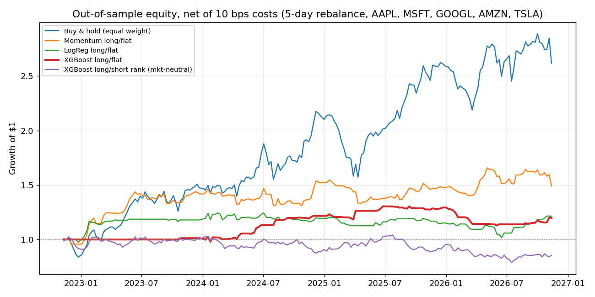

# Backtest results

Out-of-sample period: **2022-11-10 → 2026-11-19** · 5 stocks · 5-fold purged walk-forward · 5-day horizon, non-overlapping rebalances · long/flat threshold P(up) > 0.55 · costs 10 bps per unit turnover.

## Classification vs baselines (all OOS rows)

| model                       | accuracy   |   auc |
|:----------------------------|:-----------|------:|
| Always UP (baseline)        | 55.1%      | 0.5   |
| Momentum: sign of 5d return | 50.7%      | 0.497 |
| Logistic regression         | 49.0%      | 0.496 |
| XGBoost (tuned)             | 50.0%      | 0.494 |

## Strategy performance (net of costs unless noted)

| strategy                              |   sharpe_gross | cagr   | ann_vol   |   sharpe | max_drawdown   | hit_rate   |   avg_turnover |   avg_exposure |   n_periods |
|:--------------------------------------|---------------:|:-------|:----------|---------:|:---------------|:-----------|---------------:|---------------:|------------:|
| Buy & hold (equal weight)             |           1.08 | 27.1%  | 25.2%     |     1.08 | -27.8%         | 55.4%      |           0    |           1    |         202 |
| Momentum long/flat                    |           0.87 | 10.5%  | 15.7%     |     0.71 | -13.8%         | 50.0%      |           0.49 |           0.54 |         202 |
| LogReg long/flat                      |           0.66 | 5.0%   | 10.3%     |     0.52 | -18.2%         | 29.2%      |           0.29 |           0.29 |         202 |
| XGBoost long/flat                     |           0.74 | 4.6%   | 7.4%      |     0.65 | -13.5%         | 20.8%      |           0.15 |           0.18 |         202 |
| XGBoost long/short rank (mkt-neutral) |          -0.01 | -3.8%  | 13.6%     |    -0.22 | -24.3%         | 47.0%      |           0.56 |           1    |         202 |

## Cost sensitivity — XGBoost long/flat

|   cost_bps | cagr   |   sharpe |
|-----------:|:-------|---------:|
|          0 | 5.4%   |     0.74 |
|          5 | 5.0%   |     0.7  |
|         10 | 4.6%   |     0.65 |
|         20 | 3.9%   |     0.55 |

## Is the edge real?

- **Overall skill: permutation test on AUC (1010 non-overlapping obs):** AUC = 0.485 vs null 0.499, **p = 0.766**
- **Stock-picking skill: mean weekly rank IC (202 dates, returns shuffled within each date):** IC = -0.018 vs null +0.001, **p = 0.694**
- **Block bootstrap, Sharpe(XGBoost long/flat) − Sharpe(buy & hold):** -0.43, 95% CI [-1.80, +0.59]

## By volatility regime (XGBoost)

| regime   |    n | base_rate_up   | accuracy   |   auc |
|:---------|-----:|:---------------|:-----------|------:|
| low VIX  | 1690 | 53.8%          | 49.1%      | 0.496 |
| mid VIX  | 1685 | 53.4%          | 49.0%      | 0.497 |
| high VIX | 1675 | 58.2%          | 52.1%      | 0.496 |
